# Redesigned figure gallery

The 16 current presentation assets below cover all 20 earlier exports. They use the reviewed redesign without changing scientific estimates. Viewing order and main/appendix placement remain provisional.

[Combined review PDF](review.pdf) | [Contact sheet](contact_sheet.pdf) | [Full captions](CAPTIONS.md) | [Old-to-new mapping](old_to_new.csv)

For offline browsing, open `START_HERE.html` after downloading this folder or build the viewing ZIP with `python scripts/package_redesigned_figures.py --out PATH.zip` from the repository root.

The historical numbered PDF/PNG paths are compatibility copies of these new assets, not additional experiments. Some paths intentionally share a combined figure. Original hash-bound experiment SVGs remain in their evidence archives for provenance.

## 01. Matched-history test

Correct categorical facts and correct references do not always screen off source history.

Provisional placement: **main**. Evidence: prospective confirmation.

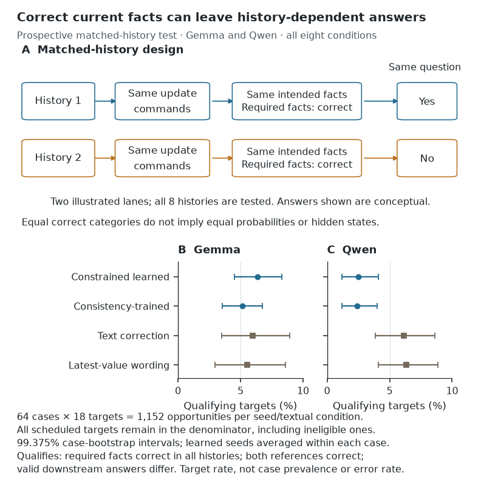

[PDF](matched_history.pdf) | [SVG](matched_history.svg) | [High-resolution PNG](matched_history.zoom.png) | [Grayscale](matched_history.gray.png)

## 02. Construct validity

Contextual relation decoding exceeds the tested wording baseline, with bounded construct validity.

Provisional placement: **main**. Evidence: development evaluation, not strict-test confirmation.

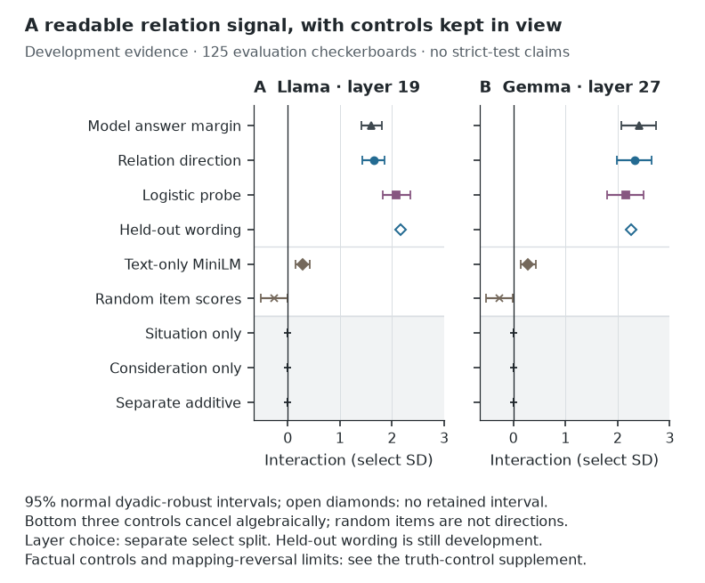

[PDF](construct_validity.pdf) | [SVG](construct_validity.svg) | [High-resolution PNG](construct_validity.zoom.png) | [Grayscale](construct_validity.gray.png)

## 03. Consequence qualification

Within this qualification-limited assay, matching a direct margin need not reproduce natural consequences.

Provisional placement: **main-qualified**. Evidence: qualification-limited/exploratory; strong-target failures; Llama natural reference unqualified.

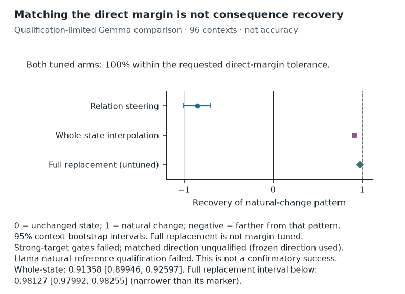

[PDF](consequence_qualification.pdf) | [SVG](consequence_qualification.svg) | [High-resolution PNG](consequence_qualification.zoom.png) | [Grayscale](consequence_qualification.gray.png)

## 04. Fresh confirmation and utility

Stronger fixed controls confirm recurrence; equal-read-budget practical advantage remains uncertain.

Provisional placement: **main**. Evidence: fresh confirmation plus held-out utility comparison; utility superiority not established.

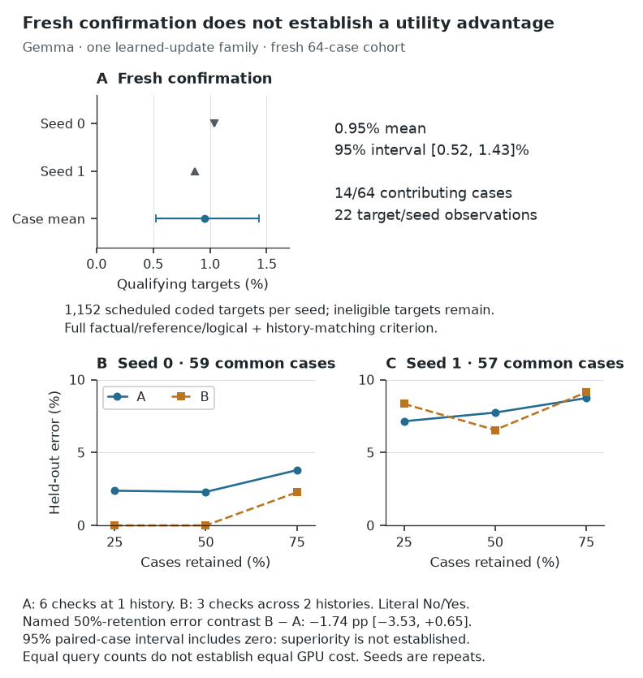

[PDF](fresh_confirmation_utility.pdf) | [SVG](fresh_confirmation_utility.svg) | [High-resolution PNG](fresh_confirmation_utility.zoom.png) | [Grayscale](fresh_confirmation_utility.gray.png)

## 05. Selected crossover

Coarse activation-source intervention changes downstream answer while direct facts remain correct.

Provisional placement: **main**. Evidence: selected mechanistic demonstration, format-sensitive in the six-case panel.

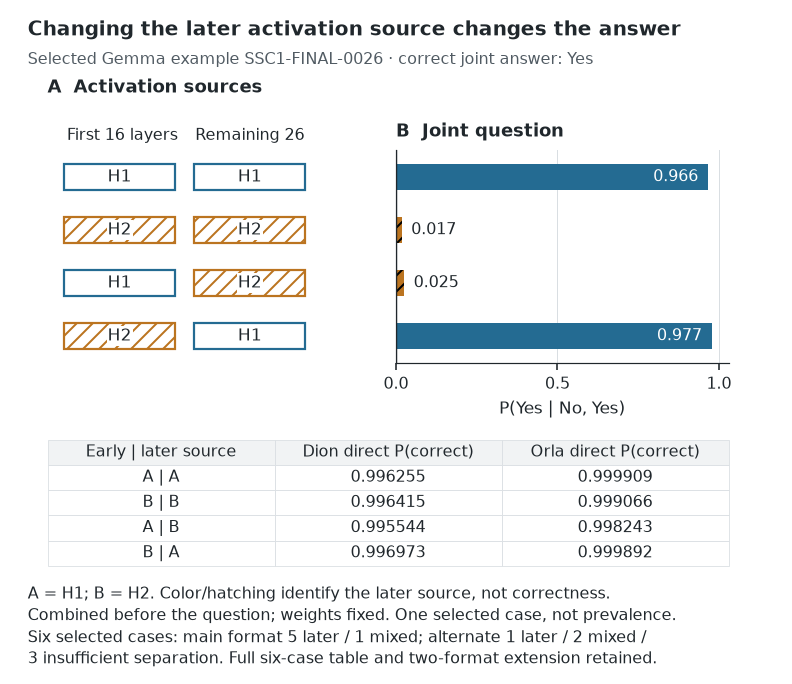

[PDF](selected_crossover.pdf) | [SVG](selected_crossover.svg) | [High-resolution PNG](selected_crossover.zoom.png) | [Grayscale](selected_crossover.gray.png)

## 06. Repair benefit and damage

Partial refresh improves net joint answers, but introduces errors and does not meet strong repair.

Provisional placement: **main**. Evidence: prospective partial repair; strong-repair threshold failed.

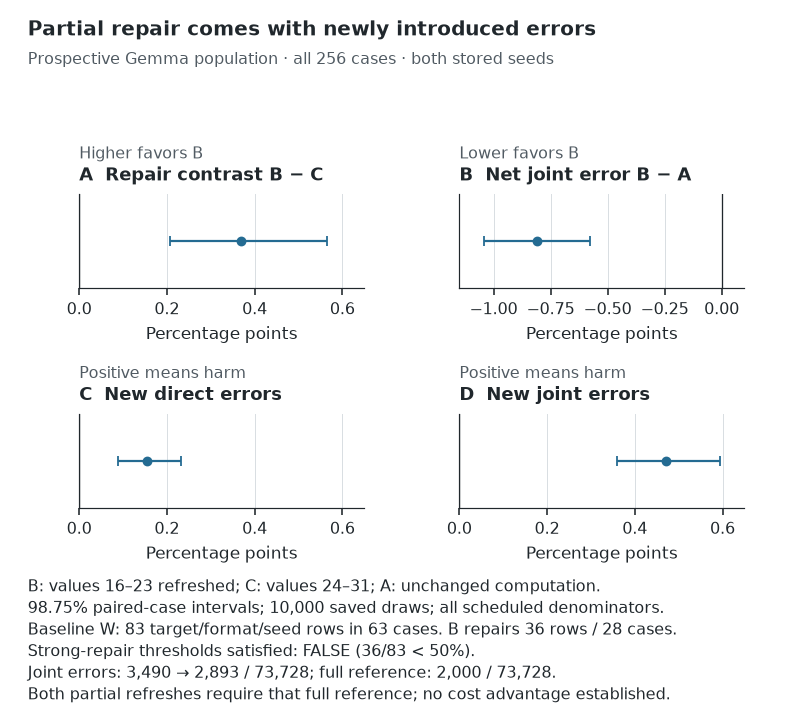

[PDF](repair_benefit_damage.pdf) | [SVG](repair_benefit_damage.svg) | [High-resolution PNG](repair_benefit_damage.zoom.png) | [Grayscale](repair_benefit_damage.gray.png)

## 07. Update reliability

Procedure-specific gains do not establish generally reliable downstream coherence.

Provisional placement: **appendix**. Evidence: supporting matched method comparison, mixed Gemma result.

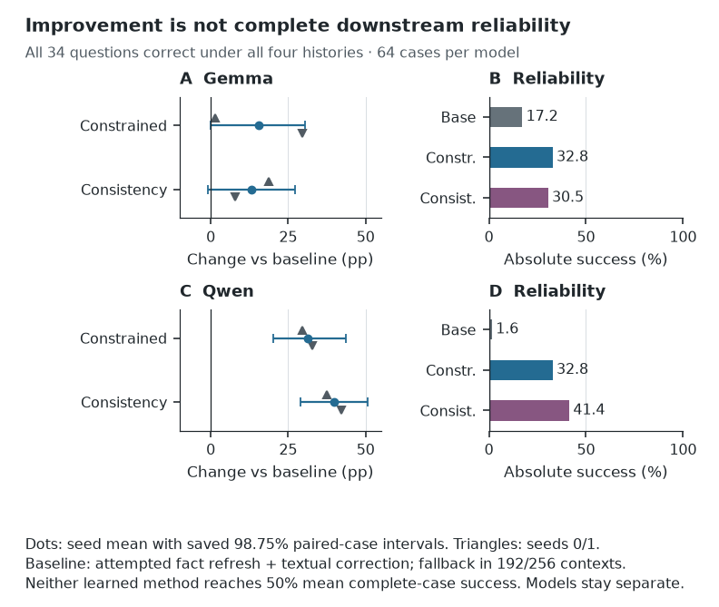

[PDF](update_reliability.pdf) | [SVG](update_reliability.svg) | [High-resolution PNG](update_reliability.zoom.png) | [Grayscale](update_reliability.gray.png)

## 08. Layer development

Later-layer decodability emerges in development data.

Provisional placement: **appendix**. Evidence: development layer sweep.

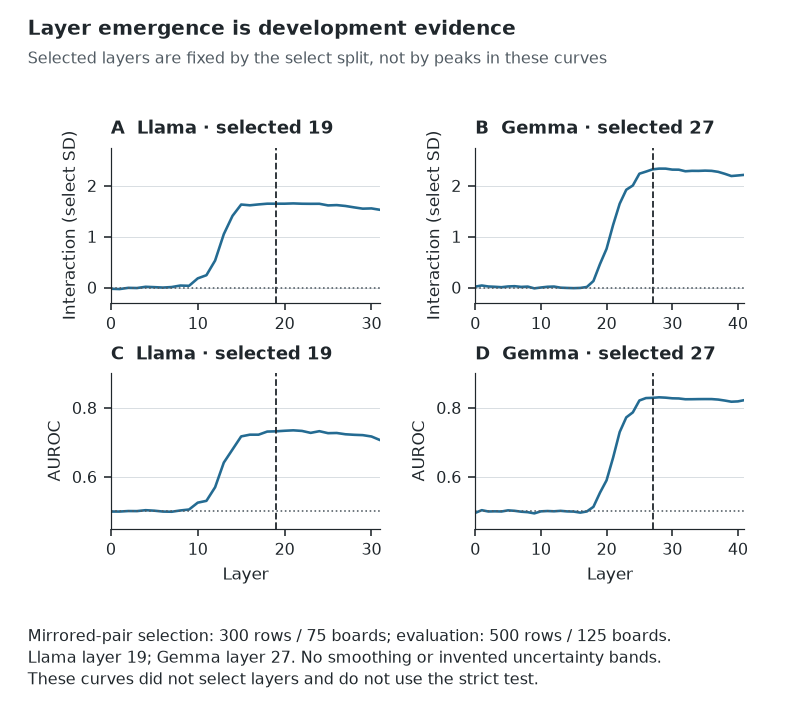

[PDF](layer_development.pdf) | [SVG](layer_development.svg) | [High-resolution PNG](layer_development.zoom.png) | [Grayscale](layer_development.gray.png)

## 09. Permutation nulls

Observed interaction exceeds each randomized-label baseline without concealing differing null shapes.

Provisional placement: **appendix**. Evidence: development inference; Llama later refitted-interaction null differs from historical improvement null.

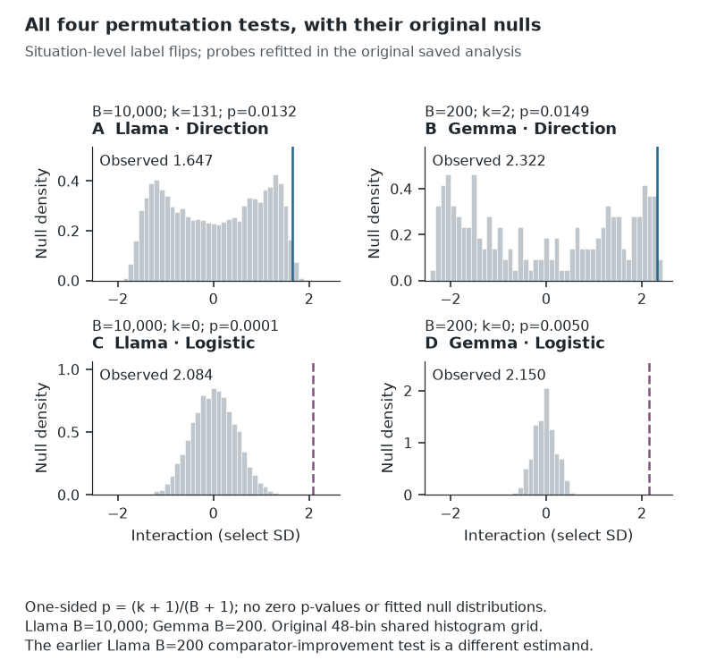

[PDF](permutation_nulls.pdf) | [SVG](permutation_nulls.svg) | [High-resolution PNG](permutation_nulls.zoom.png) | [Grayscale](permutation_nulls.gray.png)

## 10. Truth control

Factual semantic control passes at selected layers, with residual later-layer answer-format sensitivity.

Provisional placement: **appendix**. Evidence: separate factual positive control; development selection vs held-out tests explicit.

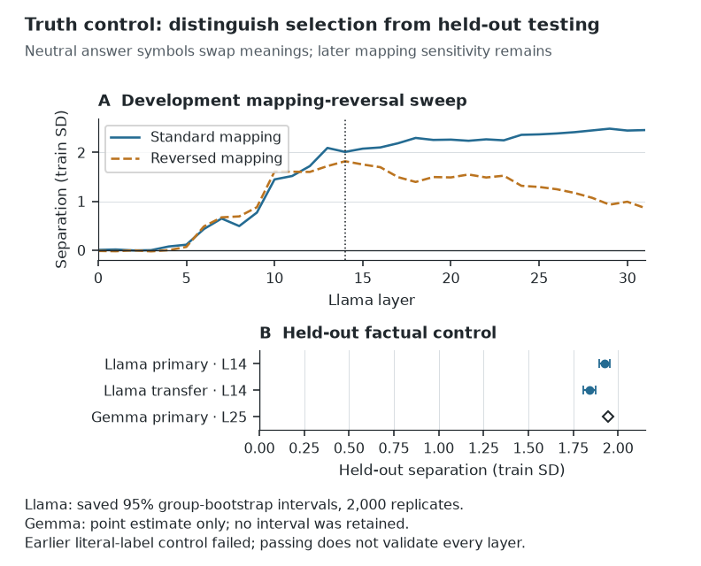

[PDF](truth_control.pdf) | [SVG](truth_control.svg) | [High-resolution PNG](truth_control.zoom.png) | [Grayscale](truth_control.gray.png)

## 11. Crossover extension

Later-source effect appears in both formats of one count/length-matched pair.

Provisional placement: **appendix**. Evidence: selected retrospective mechanistic extension.

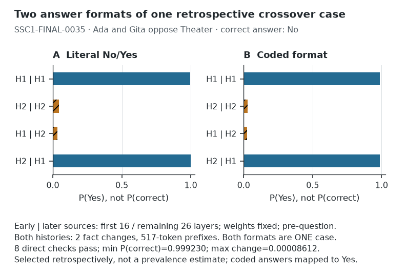

[PDF](crossover_extension.pdf) | [SVG](crossover_extension.svg) | [High-resolution PNG](crossover_extension.zoom.png) | [Grayscale](crossover_extension.gray.png)

## 12. Editing coverage

Broader single-edit coverage helps three comparisons; no broad external generalization claim.

Provisional placement: **appendix**. Evidence: bounded within-study training-coverage comparison.

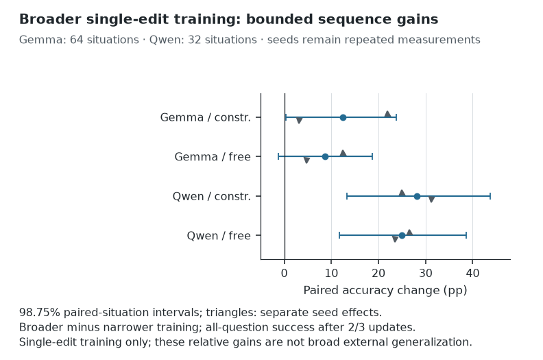

[PDF](editing_coverage.pdf) | [SVG](editing_coverage.svg) | [High-resolution PNG](editing_coverage.zoom.png) | [Grayscale](editing_coverage.gray.png)

## 13. Fixed readers

Changing the readout interface does not establish improved original-interface accuracy.

Provisional placement: **appendix**. Evidence: fixed-reader robustness comparison, not equivalence evidence.

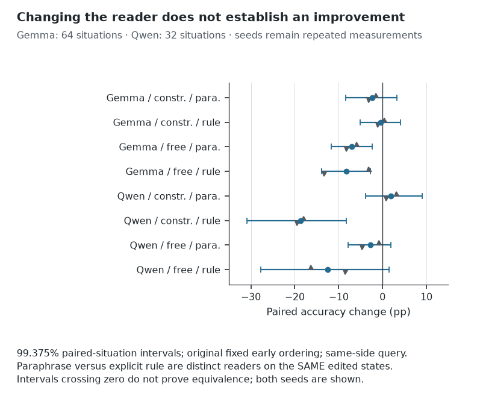

[PDF](fixed_readers.pdf) | [SVG](fixed_readers.svg) | [High-resolution PNG](fixed_readers.zoom.png) | [Grayscale](fixed_readers.gray.png)

## 14. Archival source history

Some atomic-perfect archived cases have differing joint answers; stable answers may still be wrong.

Provisional placement: **appendix**. Evidence: V6 descriptive archival evidence, distinct from V10 and fresh confirmation.

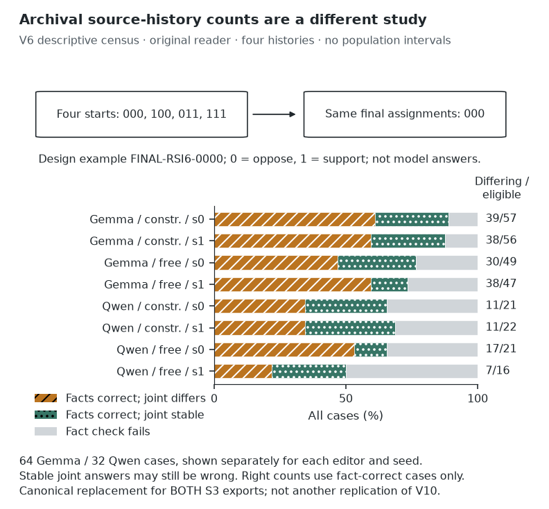

[PDF](archival_source_history.pdf) | [SVG](archival_source_history.svg) | [High-resolution PNG](archival_source_history.zoom.png) | [Grayscale](archival_source_history.gray.png)

## 15. Removal screen

Local corrections do not rescue a procedure that increases total errors and fails its damage cap.

Provisional placement: **appendix**. Evidence: closed failed branch: four of five admission gates fail.

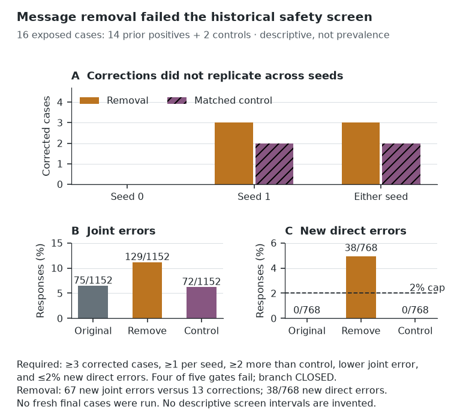

[PDF](removal_screen.pdf) | [SVG](removal_screen.svg) | [High-resolution PNG](removal_screen.zoom.png) | [Grayscale](removal_screen.gray.png)

## 16. Fixed worked example

The intervention design includes an automatic invariant reference and many already-correct answers.

Provisional placement: **appendix**. Evidence: outcome-independent descriptive worked example; not a selected successful repair.

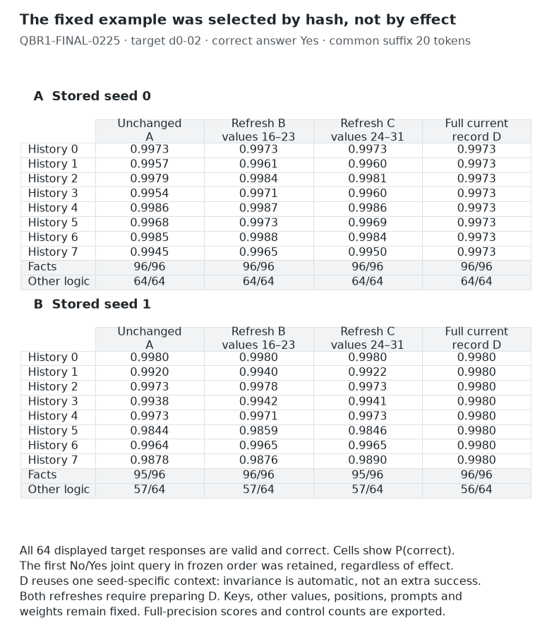

[PDF](fixed_worked_example.pdf) | [SVG](fixed_worked_example.svg) | [High-resolution PNG](fixed_worked_example.zoom.png) | [Grayscale](fixed_worked_example.gray.png)
