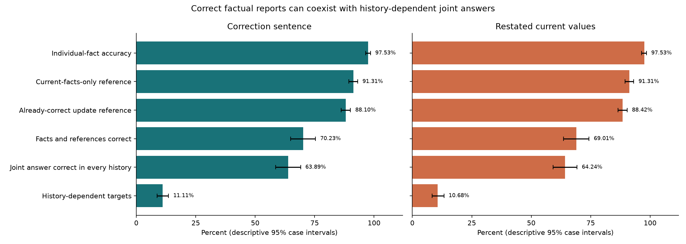
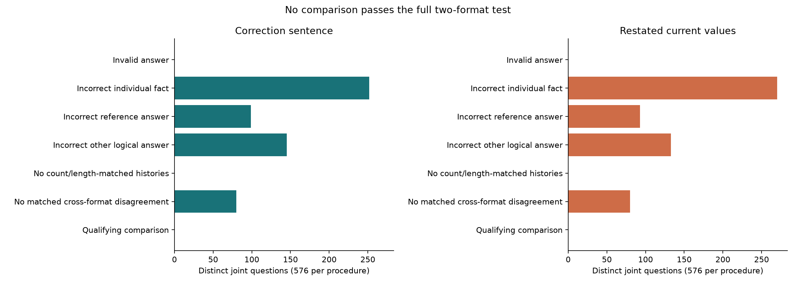

# Qwen3-32B figure captions

## Coverage and history dependence

The panels compare a correction sentence with restated current values on the
same designs. Individual facts are usually answered correctly, while some joint
answers still depend on the starting history. Error bars are descriptive 95%
design-bootstrap intervals; the primary table retains its original adjusted intervals.

## Where the strongest comparisons fail

The bars show exclusions as the same comparisons pass through successively
stronger checks. Both procedures retain 80 logically certified opportunities
across nine designs, but none then disagrees on the same matched pair in both
formats. The narrower [Yes/No example](WORKED_EXAMPLE.md) fails the other format's reference check.

## Plot provenance

[FIGURE_DATA.json](figures/FIGURE_DATA.json) contains the complete estimates,
intervals and ordered exclusion counts. [PLOTTED_VALUES.json](figures/PLOTTED_VALUES.json)
records the displayed bar widths. The CPU replay regenerates both figures using
the unchanged source plotting function and a display-label adapter.

The original [coverage plot](saved/results/FIGURE_1_COVERAGE.png) and
[attrition plot](saved/results/FIGURE_2_ATTRITION.png) are preserved byte-for-byte.
Renderer or font changes may alter image bytes without changing scientific data.
